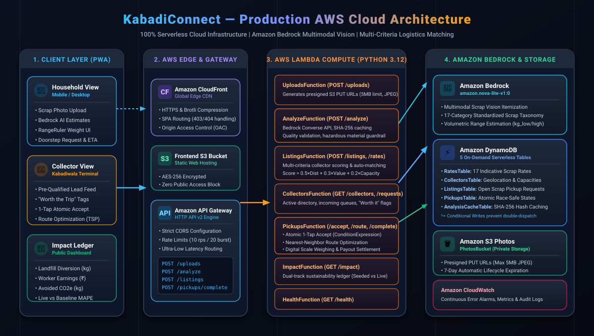
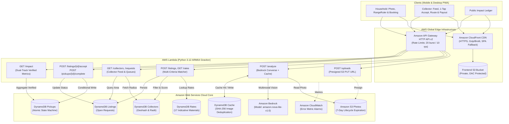
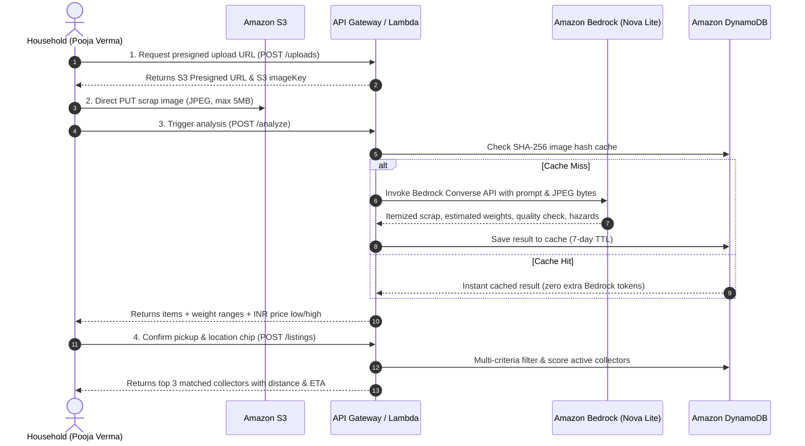
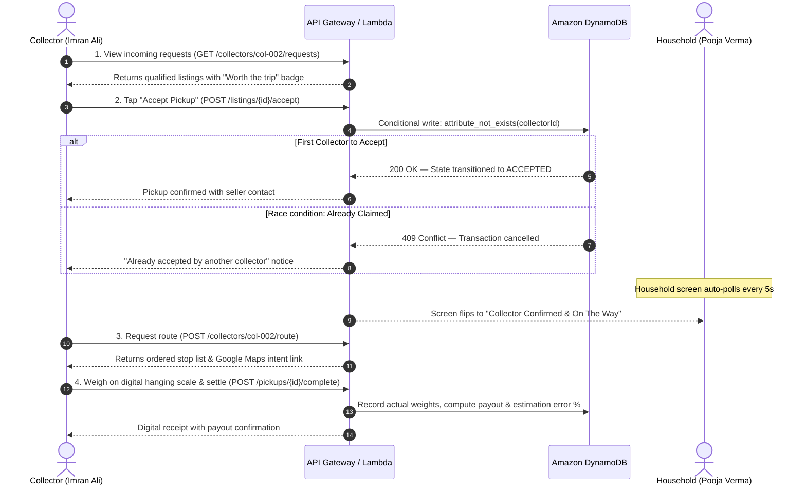

# KabadiConnect (कबाड़ी कनेक्ट)

> **"Uber-style doorstep scrap pickup for India's informal recycling economy, powered by multimodal AI on Amazon Bedrock."**  
> *Track: Environmental Hacks — Track 3 (Waste & Energy) | Built on AWS Serverless*

[](https://d3c9etytddb9yx.cloudfront.net)
[](https://xzsflevsg9.execute-api.ap-southeast-2.amazonaws.com/health)
[](https://aws.amazon.com/bedrock/)
[](https://aws.amazon.com/serverless/sam/)
[](https://react.dev)
[](https://d3c9etytddb9yx.cloudfront.net)

---

## Live Production Deployments

- **Public Frontend (CloudFront Global CDN)**:  
  [https://d3c9etytddb9yx.cloudfront.net](https://d3c9etytddb9yx.cloudfront.net)  
  *(Optimized PWA for mobile browsers and desktop, served with HTTPS and SPA routing)*

- **Public Serverless API (API Gateway HTTP API v2)**:  
  [https://xzsflevsg9.execute-api.ap-southeast-2.amazonaws.com](https://xzsflevsg9.execute-api.ap-southeast-2.amazonaws.com/health)  
  *(Backed by AWS Lambda Python 3.12, DynamoDB on-demand, and Amazon Bedrock)*

---

## The Problem and Context

In India, **over 90% of post-consumer dry waste is collected and sorted by 4–5 million informal waste collectors (*kabadiwalas*)**, who divert tens of thousands of tonnes of recyclables from municipal landfills every single day. Despite being the backbone of urban circularity, the sector faces structural inefficiencies:

1. **Information Asymmetry & Pricing Opacity**: Households do not know the fair market value of scrap (cardboard, metals, PET bottles, paper) and either hoard waste until it spoils or dump it in mixed municipal bins.
2. **Unpredictable Collection Routes**: Informal collectors wander residential neighborhoods shouting for scrap, resulting in low trip values, high fuel/pedal fatigue, and unpredictable daily earnings.
3. **Hazardous E-Waste Risks**: Dangerous items like lithium batteries and lead-laden CRT screens frequently enter informal dismantlers' hands without protective gear or proper extraction infrastructure.

---

## The Solution: KabadiConnect

**KabadiConnect** is a hyper-local, two-sided mobile platform that formalizes scrap exchange while protecting informal worker livelihoods:

- **Multimodal Vision on Amazon Bedrock**: Households snap a photo of their scrap pile. Amazon Nova Lite identifies items against a 17-material taxonomy, flags blur or bad lighting, detects hazardous materials, and calculates a fair, transparent INR price range.
- **Interactive RangeRuler**: Users easily adjust estimated weight ranges without tedious manual text input.
- **Automated Multi-Criteria Matching**: Ranks active nearby collectors within a 5 km radius based on proximity (50%), trip value (30%), and vehicle payload capacity (20%).
- **One-Tap Collector Acceptance**: Pushes pre-qualified leads with "Worth the Trip" indicators to the matched collector's mobile queue.
- **Race-Safe Concurrency**: DynamoDB conditional writes ensure that if two collectors tap "Accept" on the same request, exactly one wins and the other receives an instant notification.
- **Optimized Pickup Routing**: Heuristic route sequencing generates turn-by-turn stops with Google Maps links.
- **Hazardous Waste Separation**: Batteries and CRT monitors bypass collectors completely and direct households to certified e-waste drop-off centers.
- **Honest Impact Accounting**: A live sustainability ledger tracking landfill diversion (kg), informal worker payouts (INR), and avoided lifecycle greenhouse gas emissions (kg CO2e).

---

## System Architecture



<details>
<summary>Click to view Mermaid Architecture Flowchart</summary>


</details>

---


## User Journeys and Sequence Flows

### 1. Household Scrap Photo to Matched Collector


### 2. Collector Acceptance, Route Optimization & Scale Settlement


---

## Core Engineering Innovations

### 1. Amazon Bedrock Multimodal Vision & Image Hash Caching
- Utilizes `amazon.nova-lite-v1:0` via the Bedrock Converse API.
- Implements a strict JSON schema system prompt matching our verified 17-scrap-category taxonomy (`config/taxonomy.json`).
- Photo quality validator flags blurry, underexposed, or irrelevant photos with actionable retake guidance (`photo_quality_ok: false`).
- **Cost & Rate Guard**: Computes SHA-256 hash of image bytes. Identical uploads return in `< 20ms` from DynamoDB (`cached: true`), preventing redundant Bedrock token consumption.

### 2. Multi-Criteria Collector Matching Algorithm
Collectors are filtered by service radius (<= 5 km), accepted material categories, e-waste authorization, and available vehicle payload capacity. Qualified collectors are scored using a weighted multi-criteria function:
$$\text{Score} = 0.5 \times \text{Proximity} + 0.3 \times \min\left(1.0, \frac{\text{Trip Value}}{₹500}\right) + 0.2 \times \text{Available Capacity}$$

### 3. Concurrency Safety with DynamoDB Conditional Writes
In real-world gig economies, multiple collectors may view the same open request. KabadiConnect uses DynamoDB atomic conditional expressions:
```python
ConditionExpression="attribute_not_exists(collectorId) OR #status = :open"
```
This guarantees **strict linearizability**: exactly one collector wins the pickup, completely eliminating double-dispatch bugs without distributed locks.

### 4. Nearest-Neighbor Route Optimization
The collector route engine groups accepted doorstep pickups, runs a greedy nearest-neighbor TSP heuristic over Haversine distances, and generates turn-by-turn Google Maps deep links for seamless mobile navigation.

### 5. Honest Impact Ledger
Unlike greenwashed impact claims, the `/impact` engine maintains a strict separation:
- **`seeded_kg_diverted`**: Labeled baseline demo data.
- **`live_kg_diverted`**: Verifiable scale-weighed kilograms recorded from completed live pickups.
- **`weight_estimation_mape_pct`**: Real-world Mean Absolute Percentage Error (MAPE) calculated *exclusively* from actual scale measurements vs. AI midpoint estimates.

---

## Comprehensive API Reference

All endpoints are hosted on the public API Gateway: `https://xzsflevsg9.execute-api.ap-southeast-2.amazonaws.com`

| Method | Endpoint | Description | Key Request / Response Fields |
| :--- | :--- | :--- | :--- |
| `GET` | `/health` | Liveness & readiness probe | Returns `{ status: "healthy", version: "1.0.0", env: "production" }` |
| `GET` | `/rates` | Real-time indicative scrap price board | Returns array of 17 materials with rates (INR/kg), Hindi/English labels, and CO2e factors |
| `POST` | `/uploads` | Generates presigned S3 PUT URL | Input: `{ contentType: "image/jpeg" }` &rarr; Returns: `{ uploadUrl, imageKey, maxSizeBytes: 5242880 }` |
| `POST` | `/analyze` | Amazon Bedrock vision analysis | Input: `{ imageKey }` &rarr; Returns itemized scrap, weights, quality check, hazards, and cache status |
| `POST` | `/listings` | Submits scrap pickup & triggers matching | Input: `{ sellerName, sellerPhone, address, lat, lng, items, pickupWindow }` &rarr; Returns `{ listingId, matches }` |
| `GET` | `/listings/{id}` | Polls listing status & assigned collector | Returns listing status (`OPEN`, `ACCEPTED`, `COMPLETED`) and collector details |
| `GET` | `/collectors` | Directory of active scrap collectors | Returns active collectors with locations, vehicle capacities, and accepted scrap categories |
| `GET` | `/collectors/{id}/requests` | Collector's incoming request queue | Returns eligible open listings in collector's radius with "Worth the trip" flags |
| `POST` | `/listings/{id}/accept` | Atomic one-tap collector acceptance | Input: `{ collectorId }` &rarr; Transitions listing to `ACCEPTED` and initializes pickup |
| `POST` | `/collectors/{id}/route` | Generates optimized pickup sequence | Input: `{ collectorId, currentLat, currentLng }` &rarr; Returns ordered stops, km, and Google Maps URL |
| `POST` | `/pickups/{id}/complete` | Doorstep scale weighing & settlement | Input: `{ weighedItems: [{ material, weight_kg }] }` &rarr; Computes payout (INR) and estimation error % |
| `GET` | `/impact` | Public sustainability and income metrics | Returns total kg diverted, collector income (INR), CO2e avoided, and live MAPE accuracy |

---

## Repository Structure

```
Kabaddi-connect/
├── README.md                  # Comprehensive architectural guide & documentation
├── template.yaml              # AWS SAM CloudFormation template (Lambdas, DynamoDB, S3, CloudFront)
├── samconfig.toml             # AWS SAM deployment configuration
├── backend/
│   ├── common/                # Shared utilities: db.py, matching.py, geo.py, schema.py, errors.py
│   ├── functions/
│   │   ├── health/            # GET /health
│   │   ├── uploads/           # POST /uploads (presigned S3 PUT)
│   │   ├── analyze/           # POST /analyze (Amazon Bedrock Converse API + cache)
│   │   ├── listings/          # GET /rates, POST /listings, POST /listings/{id}/accept
│   │   ├── collectors/        # GET /collectors, /requests, POST /route
│   │   ├── pickups/           # POST /pickups/{id}/complete, GET /pickups
│   │   └── impact/            # GET /impact (dual-track verified metrics)
│   ├── requirements.txt       # Python dependencies (boto3, botocore, etc.)
│   └── tests/                 # Unit test suite (31 tests covering matching, schemas, error recovery)
├── frontend/                  # Modern PWA: Vite + React 19 + TypeScript + Tailwind CSS
│   ├── src/
│   │   ├── api/               # Typed client calling the live AWS API Gateway
│   │   ├── components/        # HouseholdSnap, RangeRuler, Review, MatchedView, CollectorView, ImpactDashboard
│   │   ├── i18n/              # Complete bilingual English & Hindi dictionary
│   │   └── types/             # Strict TypeScript models
│   ├── index.html             # HTML entry point with Yatra One & Mukta typography
│   └── vite.config.ts         # Vite build configuration
├── config/
│   ├── taxonomy.json          # 17-item standardized scrap taxonomy
│   ├── rates.seed.json        # Indicative Delhi-NCR baseline scrap rates (INR/kg)
│   └── emission_factors.json  # Lifecycle CO2e avoided factors per kg recycled
├── seed/
│   ├── collectors.json        # 10 realistic synthetic collectors in North West Delhi
│   ├── listings.json          # Sample listings covering high-value, mixed, and e-waste items
│   ├── ewaste_points.json     # Authorized e-waste drop-off facilities
│   └── seed.py                # Idempotent DynamoDB seeder with stack output discovery
├── scripts/
│   ├── reset_demo.py          # Fast demo environment reset (< 10 seconds)
│   └── smoke_test.py          # Complete 10-step end-to-end API smoke test
├── eval/
│   ├── labels.csv             # Measured ground-truth weights and photo metadata
│   └── run_eval.py            # Computer vision evaluation tool (Precision, Recall, MAPE)
└── docs/
    ├── blog.md                # AWS Builder Center publication draft
    ├── demo-script.md         # 3-minute video presentation script
    └── eval-results.md        # Computer vision benchmark results
```

---

## Local Development and Setup

### Prerequisites
- [Node.js](https://nodejs.org/) (v18 or higher)
- [Python 3.12](https://www.python.org/)
- [AWS CLI](https://aws.amazon.com/cli/) configured with active credentials
- [AWS SAM CLI](https://docs.aws.amazon.com/serverless-application-model/latest/developerguide/install-sam-cli.html)

### 1. Run the Frontend Locally
```bash
cd frontend

# Install dependencies
npm install

# Start development server with LAN broadcast for mobile testing
npm run dev -- --host
```
- Open `http://localhost:5173/` on your computer.
- Open `http://<your-local-ip>:5173/` on your smartphone (connected to the same Wi-Fi).

### 2. Run Backend Unit Tests
```bash
# Run complete test suite (31 tests)
pytest backend/tests
```

### 3. Run End-to-End Cloud Smoke Test
Test the full pipeline against the deployed AWS cloud backend:
```bash
python3 scripts/smoke_test.py --api-url https://xzsflevsg9.execute-api.ap-southeast-2.amazonaws.com
```

---

## Deployment Instructions (AWS SAM)

To deploy your own instance of the complete stack to AWS:

```bash
# 1. Build the serverless application
sam build

# 2. Deploy to AWS
sam deploy --guided
```

When prompted:
- **Stack Name**: `kabadiconnect`
- **AWS Region**: `ap-southeast-2` (or your preferred region with Bedrock Nova Lite)
- **BedrockModelId**: `amazon.nova-lite-v1:0`
- Confirm IAM role creation

### Seed DynamoDB Tables
```bash
python3 seed/seed.py --region ap-southeast-2 --stack-name kabadiconnect
```

### Deploy the Frontend to S3 + CloudFront
```bash
# 1. Build frontend production bundle
cd frontend && npm run build && cd ..

# 2. Sync to the CloudFormation-created S3 bucket
aws s3 sync frontend/dist s3://<FrontendBucketName> --delete

# 3. Invalidate CloudFront cache
aws cloudfront create-invalidation --distribution-id <DistributionId> --paths "/*"
```

---

## Honest Disclosures and Known Limitations

- **Vision Weight Estimation**: Weights estimated from single 2D photos are approximate volumetric approximations. The user is provided an interactive RangeRuler slider to adjust them, and final legal settlement always occurs on certified digital scales at the doorstep.
- **Synthetic Seed Data**: Collector profiles and initial demo listings are synthetic fixtures centered in North West Delhi (Rohini, DTU, Pitampura, Shalimar Bagh) to allow judges to test realistic geographic clustering.
- **E-Waste Drop-Off Points**: Drop-off centers are marked with an *"Unverified"* badge in the UI until physically audited by certified recyclers.
- **Authentication**: Uses client-side role switching for zero-friction hackathon judging; production rollout would implement AWS Cognito with SMS OTP for informal collectors.

---

## Hackathon Team and Track

- **Hackathon**: Environmental Hacks 2026
- **Track**: Track 3 — Waste and Energy
- **Team**: Omnivision
- **License**: MIT
