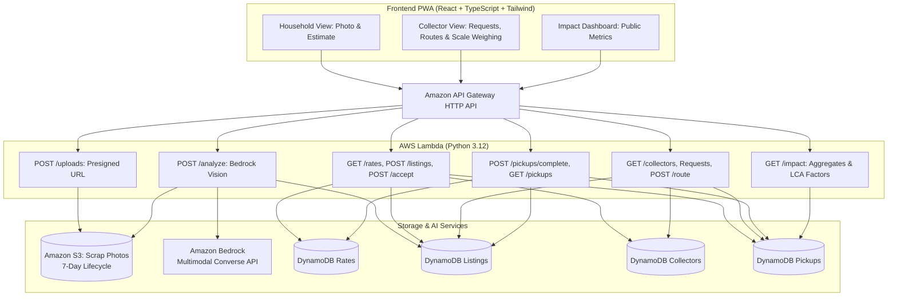

# KabadiConnect (कबाड़ी कनेक्ट)

> **"Uber-style pickup for the informal recycling economy, with an AI that tells you what your scrap is worth."**  
> Hackathon: Environmental Hacks, Track 3 (Waste and Energy) | Team: Omnivision

KabadiConnect bridges Indian households with local informal scrap collectors (kabadiwalas) through multimodal AI on **Amazon Bedrock**. Households photograph their recyclables to receive an instant, transparent price range and schedule doorstep collection, while collectors receive pre-qualified, geo-clustered pickup requests with optimized routes.

---

## Architecture



### AWS Services Used
- **Amazon Bedrock (Converse API)**: Multimodal scrap classification and weight band estimation with strict 17-material taxonomy enforcement.
- **AWS Lambda (Python 3.12)**: Serverless compute with least-privilege IAM policies.
- **Amazon DynamoDB (On-Demand)**: Pay-per-request storage across Rates, Listings, Collectors, and Pickups with conditional writes for race-safe order acceptance.
- **Amazon S3**: Private photo storage with 7-day lifecycle expiration and presigned upload URLs (JPEG only, 5 MB limit).
- **Amazon API Gateway HTTP API**: Low-latency endpoints with CORS configuration.
- **Amazon CloudWatch**: Alarm monitoring Lambda error rates.
- **AWS SAM (Serverless Application Model)**: Reproducible Infrastructure-as-Code.

---

## Repository Structure

```
kabadiconnect/
├── README.md                  # Comprehensive project & deploy guide
├── template.yaml              # AWS SAM template (7 Lambdas, 4 DynamoDB tables, S3 bucket, Alarm)
├── samconfig.toml             # SAM deployment defaults
├── backend/
│   ├── common/                # db.py, matching.py, geo.py, schema.py, errors.py
│   ├── functions/
│   │   ├── health/            # GET /health
│   │   ├── uploads/           # POST /uploads (presigned PUT)
│   │   ├── analyze/           # POST /analyze (Bedrock Converse multimodal)
│   │   ├── listings/          # GET /rates, POST /listings, POST /listings/{id}/accept
│   │   ├── collectors/        # GET /collectors, /requests, POST /route
│   │   ├── pickups/           # POST /pickups/{id}/complete, GET /pickups
│   │   └── impact/            # GET /impact (live aggregates + demo baseline)
│   ├── requirements.txt       # Python dependencies
│   └── tests/                 # Unit test suite (22 unit tests)
├── frontend/                  # Vite + React 19 + TypeScript + Tailwind CSS PWA
│   ├── src/
│   │   ├── api/               # API client with full endpoint bindings
│   │   ├── components/        # Snap, Review, PickupDetails, MatchedView, CollectorView, ImpactDashboard
│   │   ├── i18n/              # Complete bilingual English & Hindi dictionary
│   │   └── types/             # Full TypeScript interfaces
├── config/
│   ├── taxonomy.json          # 17-item material taxonomy
│   ├── rates.seed.json        # Indicative scrap market rates (₹/kg)
│   └── emission_factors.json  # CO2e avoided factors per kg recycled
├── seed/
│   ├── collectors.json        # 10 synthetic collectors in North West Delhi
│   ├── listings.json          # 8 sample listings (with clustering & low-value sample)
│   ├── ewaste_points.json     # 3 authorised e-waste drop-off points (unverified flagged)
│   └── seed.py                # Idempotent DynamoDB seeder with --reset support
├── scripts/
│   ├── reset_demo.py          # Fast demo environment reset (< 10 seconds)
│   └── smoke_test.py          # 10-step end-to-end API test against deployed backend
├── eval/
│   ├── labels.csv             # Ground truth scrap test photos and measured weights
│   └── run_eval.py            # Precision, recall, and MAPE evaluation tool
└── docs/
    ├── blog.md                # AWS Builder Center publication draft
    ├── demo-script.md         # 3-minute video presentation script
    └── eval-results.md        # Generated model evaluation report
```

---

## Deployment & Setup

### Prerequisites
1. [AWS CLI](https://aws.amazon.com/cli/) configured with valid credentials (`aws configure`)
2. [AWS SAM CLI](https://docs.aws.amazon.com/serverless-application-model/latest/developerguide/install-sam-cli.html) (`sam --version`)
3. [Python 3.12](https://www.python.org/)
4. [Node.js](https://nodejs.org/) (v18+ or v20+)

---

### Step 1: Deploy Backend with AWS SAM

```bash
# Build Lambda packages
sam build

# Deploy to AWS (interactive guided mode on first run)
sam deploy --guided
```

When prompted:
- **Stack Name**: `kabadiconnect`
- **AWS Region**: `ap-south-1` (Mumbai)
- **BedrockModelId**: `apac.amazon.nova-lite-v1:0` (or `anthropic.claude-3-haiku-20240307-v1:0`)
- **BedrockRegion**: `ap-south-1`
- Confirm creation of IAM roles and API Gateway authorization

Note down the **`HttpApiUrl`** output from SAM deploy.

---

### Step 2: Seed the Tables

Populate DynamoDB tables with North West Delhi seed data (Rates, Collectors, Listings, E-Waste Points):

```bash
python seed/seed.py --region ap-south-1
```

To reset the demo state at any time:
```bash
python scripts/reset_demo.py
```

---

### Step 3: Run the Frontend Locally

```bash
cd frontend

# Install dependencies
npm install

# Start development server
VITE_API_URL="https://<your-api-id>.execute-api.ap-south-1.amazonaws.com" npm run dev
```

Open `http://localhost:5173` in your browser.

To verify a production build:
```bash
npm run build
```

---

### Step 4: Run Tests & Evaluation

#### 1. Backend Unit Tests (22 unit tests)
Covers taxonomy validation, Bedrock output recovery, price ranges, matching algorithm, e-waste drop-off routing, and route optimization:
```bash
python -m unittest discover backend/tests
```

#### 2. Model Evaluation Tool
Evaluates precision/recall and weight estimation MAPE, generating `docs/eval-results.md`:
```bash
python eval/run_eval.py --split report
```

#### 3. End-to-End API Smoke Test
Runs a complete 10-step smoke test against the deployed API Gateway:
```bash
python scripts/smoke_test.py --api-url https://<your-api-id>.execute-api.ap-south-1.amazonaws.com
```

---

## Known Limitations & Honest Disclosures

- **Weight Accuracy**: Weights estimated from single 2D photos are approximate ranges, not legal metrology measurements. Household users can adjust estimated weights using sliders, and final payouts are determined on digital hanging scales during doorstep collection.
- **Indicative Rates**: Seeded rates reflect general Delhi-NCR market averages.
- **Synthetic Seed Data**: Collector profiles and initial listings are synthetic demo fixtures focused in North West Delhi (Rohini, DTU, Bawana).
- **E-Waste Drop-Off Points**: Sourced from public directory listings; labeled `UNVERIFIED - CHECK BEFORE VISITING` in UI until physically audited.
- **Authentication**: Authentication in the demo prototype is role-based (localStorage session) to allow rapid judging without SMS OTP friction.
